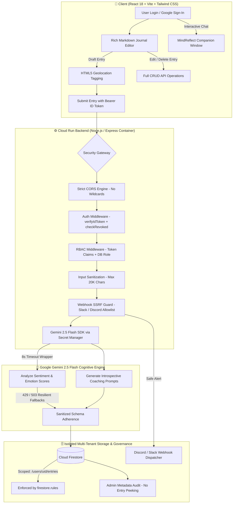

# 📔 MindReflect AI — Secure AI Journal on Google Cloud Run

<div align="center">

[](https://secure-ai-journal-app-br3843311-7472s-projects.vercel.app)
[](https://cloud.google.com/run)
[](https://cloud.google.com/vertex-ai)
[](SECURITY.md#6-comprehensive-automated-test-matrix)
[](SECURITY.md)
[](LICENSE)

<br>

**🏆 Official Submission for the Google Cloud Gen AI Academy APAC Edition Ideathon Challenge.**  
*A privacy-first, intelligent journaling companion featuring real-time emotion scoring, contextual AI self-reflection prompts, zero-trust user isolation, and resilient Cloud Run serverless deployment.*

</div>

---

## 🌐 Live Demos & Links

- 🚀 **Live Interactive Web App**: [secure-ai-journal-app-br3843311-7472s-projects.vercel.app](https://secure-ai-journal-app-br3843311-7472s-projects.vercel.app)
- ☁️ **Production Cloud Run Backend**: `https://mindreflect-ai-journal-571017174215.us-central1.run.app` (Label: `dev-tutorial=cloud-run-ai-challenge`)
- 📢 **Official Demo Video / Post**: [LinkedIn Post with #AccelerateAIwithCloudRun](https://lnkd.in/p/e9jNfGD2)
- 📦 **Source Code Repository**: [github.com/ranjithbrs/secure-ai-journal-app](https://github.com/ranjithbrs/secure-ai-journal-app)
- 🎬 **2-Minute Demo Script**: [docs/DEMO_SCRIPT.md](docs/DEMO_SCRIPT.md)
- 🛡️ **Full Security & Audit Report**: [SECURITY.md](SECURITY.md)

---

## 💡 What is MindReflect AI in 30 Seconds?

Have you ever written your personal thoughts, daily stress, or goals in a notebook or diary, but wished you had an empathetic companion to help you process your feelings without risking your privacy?

**MindReflect AI** is a **private, intelligent digital diary** that listens, scores your emotional mood, and helps you grow:
- ✍️ **Write Freely:** Express how your day went, what stressed you out, or what made you proud. Full CRUD support lets you create, edit, and delete reflections at any time.
- 🧘 **Emotional Mood Scoring:** The AI automatically detects your mood (Joy, Optimism, Stress, Anxiety, Fatigue) and provides a quantitative sentiment score.
- 🌱 **Thoughtful Self-Reflection Prompts:** Instead of robotic summaries, Gemini 2.5 Flash asks gentle, supportive follow-up questions to help you reflect deeper.
- 💬 **Interactive AI Companion:** Real-time conversational therapy-grounded companion to talk through difficult feelings safely.
- 🔒 **Zero-Trust Privacy:** Your private entries are locked with database-level security rules so **only you** can ever read them — not even the system administrators!

---

## 📐 System Architecture & Data Flow



---

## ✨ Key Technical Highlights

### 1. Gemini 2.5 Flash Cognitive Engine & Reliability
- **Automated Sentiment Classification**: Evaluates multi-dimensional emotional depth (`positive`, `reflective`, `neutral`, `stressed`, `anxious`, `inspired`).
- **Contextual Coaching Prompts**: Dynamically crafts supportive introspective questions tailored to your entry.
- **Fail-Safe Timeout Guard (`withTimeout`)**: Enforces an 8-second execution ceiling on upstream AI calls so worker threads never hang.
- **Rate Limit & Outage Fallback**: Catches `429 RESOURCE_EXHAUSTED` and `503 UNAVAILABLE` errors gracefully, returning deterministic reflection structures so user data is **never lost**.

### 2. Zero-Trust Privacy & Multi-Tenant Security
- **Strict Firestore Security Rules (`firestore.rules`)**: User reflections are partitioned strictly under `/users/{userId}/entries/{entryId}`. Verified with custom rules emulator integration tests.
- **SSRF Defense on Notification Webhooks**: Protocol strictly HTTPS, destination restricted strictly to `hooks.slack.com` and `discord.com`/`discordapp.com`, and blocks private subnets (`10.0.0.0/8`, `172.16.0.0/12`, `192.168.0.0/16`), loopback, and cloud metadata (`169.254.169.254`).
- **Explicit CORS Allowlist**: Removed permissive `*` wildcards. Production origins explicitly restricted to verified Vercel and Cloud Run hosts.
- **Active Token Revocation**: Calls `auth.verifyIdToken(idToken, true)` so logged-out or compromised sessions are revoked immediately.
- **Admin Privilege Boundaries**: Administrators can view system metrics and assign roles, but are **strictly blocked from reading user journal entries**.

### 3. Google Cloud Run Serverless Scalability
- Containerized with Docker and running as a non-root user (`USER node`).
- Deployed with the official Gen AI Academy verification tag:
  ```bash
  --update-labels dev-tutorial=cloud-run-ai-challenge
  ```
- Dynamic Google Cloud Secret Manager resolution for `GEMINI_API_KEY`.
- Auto-scales from 0 to N instances on demand.

---

## 🧪 Automated Test Suite (135 Tests Passing)

MindReflect AI includes an exhaustive native test suite (`node --test tests/*.test.js`) executing in < 1 second with **100% pass rate**:

```bash
ℹ tests 135
ℹ suites 6
ℹ pass 135
ℹ fail 0
ℹ cancelled 0
ℹ skipped 0
ℹ duration_ms 948.5321
```

| Test Suite | Tests | Primary Security & Reliability Assertions |
|---|:---:|---|
| [`tests/auth.test.js`](tests/auth.test.js) | 9 | Bearer token format, token expiration (`401 TokenExpired`), revocation check (`401 TokenRevoked`), RBAC |
| [`tests/cors.test.js`](tests/cors.test.js) | 19 | Production origins, wildcard `*` rejection, preview regexes, localhost production blocking |
| [`tests/webhook.test.js`](tests/webhook.test.js) | 29 | SSRF mitigation, cloud metadata block (`169.254.169.254`), private IP subnets, Slack/Discord allowlist |
| [`tests/firestore-rules.integration.test.js`](tests/firestore-rules.integration.test.js) | 22 | Rules emulator evaluation, cross-user denial, admin privacy, 20K char limits, privilege escalation |
| [`tests/admin-profile.test.js`](tests/admin-profile.test.js) | 12 | Profile update filtering, role modification permission checks, custom claim syncing |
| [`tests/gemini-reliability.test.js`](tests/gemini-reliability.test.js) | 12 | 8-second timeout aborts, 429 quota exhaustion, 503 service outages, corrupted JSON fallback |
| [`tests/gemini.test.js`](tests/gemini.test.js) | 12 | JSON extraction, markdown fences, sentiment clamping `[-1, 1]`, input boundary sanitization |
| [`tests/isolation.test.js`](tests/isolation.test.js) | 3 | Multi-tenant UID scoping and 20,000-character payload limits |
| [`tests/journal-crud.test.js`](tests/journal-crud.test.js) | 7 | End-to-end create, list, edit, delete, cross-user tamper prevention, 404 handling |
| [`tests/firebase-auth.test.js`](tests/firebase-auth.test.js) | 5 | Authentic token verification, claims propagation, expiration & revocation lifecycle |
| [`tests/deployment-health.test.js`](tests/deployment-health.test.js) | 5 | Cloud Run & Vercel production endpoints, health tag, security headers |

---

## 📂 Project Structure

```text
secure-ai-journal-app/
├── server/
│   ├── config/
│   │   ├── cors.js                  # Explicit CORS engine (zero wildcard default)
│   │   ├── firebase.js              # Firebase Admin SDK initialization & mock injection
│   │   └── secrets.js               # Google Cloud Secret Manager integration
│   ├── middleware/
│   │   ├── auth.js                  # Bearer token verification & revocation checks
│   │   └── admin.js                 # Role-Based Access Control (RBAC) middleware
│   ├── routes/
│   │   ├── journal.js               # Full CRUD endpoints for user reflections
│   │   ├── ai.js                    # Gemini AI sentiment analysis & companion chat
│   │   ├── admin.js                 # Admin metrics, user auditing & role assignment
│   │   ├── notification.js          # Webhook notification dispatcher with SSRF guard
│   │   └── user.js                  # User profile retrieval & safe updates
│   ├── services/
│   │   └── gemini.js                # Gemini 2.5 Flash integration with 8s timeout & fallbacks
│   ├── utils/
│   │   └── webhookValidator.js      # SSRF defense, host allowlists & private IP blocking
│   └── index.js                     # Express application entrypoint & security headers
├── src/
│   ├── firebase.js                  # Firebase Client SDK configuration
│   ├── App.jsx                      # Main UI controller (Journal, Chat, Admin RBAC tabs)
│   └── main.jsx                     # React DOM entrypoint
├── tests/
│   ├── helpers/
│   │   └── firestore-rules-evaluator.js # In-memory Firestore Rules emulator engine
│   ├── admin-profile.test.js        # RBAC & profile update tests
│   ├── auth.test.js                 # Auth middleware & token tests
│   ├── cors.test.js                 # CORS allowlist & wildcard rejection tests
│   ├── deployment-health.test.js    # Health check & origin verification tests
│   ├── firebase-auth.test.js        # Authentic Firebase token tests
│   ├── firestore-rules.integration.test.js # Cross-user isolation rules tests
│   ├── gemini-reliability.test.js   # AI timeout, 429 rate limit & outage tests
│   ├── gemini.test.js               # Parser & sanitization edge case tests
│   ├── isolation.test.js            # Path scoping tests
│   ├── journal-crud.test.js         # Full CRUD lifecycle tests
│   └── webhook.test.js              # SSRF defense & malicious URL tests
├── docs/
│   └── DEMO_SCRIPT.md               # 2-minute showcase video walkthrough script
├── firestore.rules                  # Production security rules for Firestore
├── Dockerfile                       # Multi-stage production container build (USER node)
├── deploy-cloudrun.ps1              # Deployment script for Google Cloud Run (Windows)
├── deploy-cloudrun.sh               # Deployment script for Google Cloud Run (Linux/Cloud Shell)
├── SECURITY.md                      # Comprehensive security architecture & audit report
├── package.json                     # Node.js dependencies and scripts
└── README.md                        # Project documentation
```

---

## 🚀 Quickstart & Local Setup

### 1. Clone the repository
```bash
git clone https://github.com/ranjithbrs/secure-ai-journal-app.git
cd secure-ai-journal-app
npm install
```

### 2. Configure Environment Variables (`.env`)
```env
PORT=8080
NODE_ENV=development
GEMINI_API_KEY=your_gemini_api_key_here
VITE_FIREBASE_API_KEY=your_firebase_api_key
VITE_FIREBASE_AUTH_DOMAIN=your_project.firebaseapp.com
VITE_FIREBASE_PROJECT_ID=your_project_id
VITE_FIREBASE_STORAGE_BUCKET=your_project.appspot.com
VITE_FIREBASE_MESSAGING_SENDER_ID=your_messaging_sender_id
VITE_FIREBASE_APP_ID=your_app_id
```

### 3. Run Automated Tests
```bash
npm test
# Executes all 135 tests natively with zero external dependencies
```

### 4. Run Development Server
```bash
# Start frontend (Vite)
npm run dev

# Start backend server
npm run server
```

---

## ☁️ Google Cloud Run Deployment

Deploy directly to Google Cloud Run with the official Gen AI Academy challenge verification tag:

```bash
gcloud run deploy secure-ai-journal-app \
    --source . \
    --platform managed \
    --region us-central1 \
    --allow-unauthenticated \
    --update-labels dev-tutorial=cloud-run-ai-challenge
```

Or execute the included deployment script:
```powershell
# Windows PowerShell
.\deploy-cloudrun.ps1
```
```bash
# Linux / macOS / Cloud Shell
chmod +x deploy-cloudrun.sh
./deploy-cloudrun.sh
```

---

## 👨‍💻 Author & Connect

**Ranjith B**  
🎓 *B.Tech Computer Science & Business Systems (CSBS)*  
🏛️ *Nehru Institute of Engineering and Technology, Coimbatore*  

- 💼 **LinkedIn**: [linkedin.com/in/ranjith-b-csbs](https://linkedin.com/in/ranjith-b-csbs)  
- 🐙 **GitHub**: [@ranjithbrs](https://github.com/ranjithbrs)  
- 🌐 **Portfolio**: [ranjithbrs.github.io/portfolio](https://ranjithbrs.github.io/portfolio/)  
- 📧 **Email**: ranjithb2k06@gmail.com  

---

## 📄 License

This project is licensed under the [MIT License](LICENSE).
